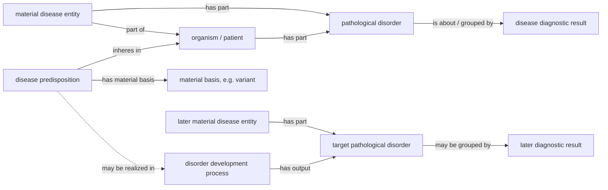

# Worked examples and competency questions

First draft for the disease-modelling proposal. The examples are written at the pattern level rather than as final ABox test data. They are intended to make explicit what the ontology should entail, what it should not entail, and where the current axioms may need adjustment before reasoner validation.

Relevant core classes:

- `material disease entity` (`WOND_120020`)
- `disorder development process` (`WOND_120021`)
- `pathological disorder` (`WOND_120022`)
- `disease predisposition` (`WOND_120023`)
- `disease diagnostic result` (`WOND_120024`)
- `course of the disease process` (`WOND_120028`)
- `material complication disease entity` (`WOND_120051`)
- `disease course process putting out disorders as part of a complication` (`WOND_120053`)

Note: these expected entailments are not yet reasoner-validated. OWL 2 DL validation currently fails on the `compound pathological disorder` cardinality axiom; see `TODO_4_DL_validation_and_final_cleanup.md`.

---

## 1. Simple single-disorder disease

### Narrative

A patient has one pathological disorder, for example an inflamed appendix or a localized pathological lesion. A clinician produces a diagnostic result that groups this disorder as one disease. The disease is not identical with the diagnostic result: the disease is the material entity constituted by the pathological disorder in the patient, while the diagnostic result is an information content entity about that disorder.

### Pattern

Individuals in the example:

- `patient_1`: an instance of `Homo sapiens`
- `disorder_1`: an instance of `pathological disorder`
- `disease_1`: an instance of `material disease entity`
- `diagnosis_1`: an instance of `disease diagnostic result`

Assertions:

```text
patient_1 type Homo sapiens
disorder_1 type pathological disorder
disorder_1 part of patient_1
disease_1 type material disease entity
disease_1 part of patient_1
disease_1 has part disorder_1
diagnosis_1 type disease diagnostic result
diagnosis_1 is about disorder_1
```

### Expected entailments

- `disorder_1` is a material entity and an OGMS disorder, via `pathological disorder`.
- `disease_1` is a material entity, via `material disease entity`.
- `disease_1` is disjoint from `disease predisposition`.
- `diagnosis_1` is an information content entity, not a material entity.
- The model allows the same material disorder to be the object of diagnosis without making the diagnosis part of the disease.

### Expected non-entailments

- The ontology should not infer that every pathological disorder already has a diagnostic result.
- The ontology should not infer that all pathological disorders in the same patient belong to the same disease.
- The diagnostic result should not be inferred to be a material disease entity.
- A disease category name should not be inferred from the material disorder unless a classification result or category-specific axiom is asserted.

---

## 2. Complication: disease A produces a disorder grouped under disease B

### Narrative

A patient has disease A, grounded in disorder set `S_A`. During the course of disease A, a process produces a new pathological disorder. That new disorder is not merely another part of disease A by default. It can be grouped by a later diagnostic result as disease B, yielding a material complication disease entity.

Example reading: diabetes-associated pathological processes produce a retinal disorder. The retinal disorder can then be grouped under diabetic retinopathy as a complication disease. The important point is not the clinical example itself, but the ontological distinction between the producing disease course and the newly grounded disease entity.

### Pattern

Individuals in the example:

- `patient_2`: an instance of `Homo sapiens`
- `disorder_A`: an instance of `pathological disorder`
- `disease_A`: an instance of `material disease entity`
- `course_A`: an instance of `course of the disease process`
- `complication_process`: an instance of `disease course process putting out disorders as part of a complication`
- `disorder_B`: an instance of `pathological disorder`
- `disease_B`: an instance of `material complication disease entity`
- `diagnosis_B`: an instance of `disease complication diagnostic result`

Assertions:

```text
patient_2 type Homo sapiens
disorder_A type pathological disorder
disorder_A part of patient_2
disease_A type material disease entity
disease_A has part disorder_A
disease_A part of patient_2

course_A type course of the disease process
course_A has participant disease_A

complication_process type disease course process putting out disorders as part of a complication
complication_process part of course_A
complication_process has output disorder_B

disorder_B type pathological disorder
disorder_B part of patient_2

disease_B type material complication disease entity
disease_B has part disorder_B
disease_B part of patient_2

diagnosis_B type disease complication diagnostic result
diagnosis_B is about disorder_B
```

### Expected entailments

- `complication_process` is a disorder development process, because `WOND_120053` is a subclass of `disorder development process`.
- `complication_process` is part of a disease course process.
- `disorder_B` is a pathological disorder and a material entity.
- `disease_B` is a material disease entity, because `material complication disease entity` subclasses `material disease entity`.
- The model can represent disease B as materially grounded in a disorder produced during the course of disease A.

### Expected non-entailments

- The ontology should not infer that `disease_A` and `disease_B` are the same disease.
- The ontology should not infer that `disorder_B` is part of `disease_A` merely because it was produced during disease A's course.
- The ontology should not infer that every disorder produced during a disease course is automatically a complication disease; a grouping/diagnostic classification still matters.
- The ontology should not infer that disease B existed before `disorder_B` was produced.

### Modelling check

This example is a good test of the proposal's central claim: material production and diagnostic grouping are distinct. The producing process belongs to the biological layer; the classification of the produced disorder as disease B belongs to the epistemic layer.

---

## 3. Genetic predisposition without the target disease

### Narrative

A patient carries a pathogenic genetic variant that grounds an elevated risk for a future disorder. The variant is a present material entity. The predisposition is a tendency inhering in the patient and grounded in that variant. The future target disorder does not yet exist.

Example reading: a patient carries a BRCA1 pathogenic variant. The variant grounds a predisposition to a future breast/ovarian pathological disorder, but the variant is not itself the target cancer disease.

### Pattern

Individuals in the example:

- `patient_3`: an instance of `Homo sapiens`
- `variant_1`: an instance of `genetic variant` or proposed `pathogenic genetic variant`
- `predisposition_1`: an instance of `genetic predisposition`
- `target_development_process`: a possible future disorder development process
- `target_disorder`: a possible future pathological disorder

Assertions for the intended biological situation:

```text
patient_3 type Homo sapiens
variant_1 type genetic variant
variant_1 part of patient_3
predisposition_1 type genetic predisposition
predisposition_1 inheres in patient_3
predisposition_1 has material basis variant_1
```

If the predisposition is realized later:

```text
target_development_process type disorder development process
target_development_process realizes predisposition_1
target_development_process has output target_disorder
target_disorder type pathological disorder
target_disorder part of patient_3
```

### Expected entailments

- `predisposition_1` is a disease predisposition and a tendency.
- `predisposition_1` is not a material disease entity.
- `predisposition_1` is not a pathological disorder.
- `variant_1` is a material entity.
- If `target_development_process` is asserted, it can be represented as producing `target_disorder`.

### Expected non-entailments

- The ontology should not infer that the target disorder already exists merely because the predisposition exists.
- The ontology should not infer that `variant_1` is itself the target disease.
- The ontology should not infer that every genetic variant is pathological.
- The ontology should not infer that every patient with the predisposition will develop the target disorder.

### Modelling check

The current OWL pattern should be checked carefully here. If `disease predisposition` has the necessary condition `has realization some disorder development process`, then classifying `predisposition_1` as a disease predisposition entails the existence of some realization process. Because `disorder development process` itself has `has output some pathological disorder`, this can indirectly entail an anonymous target disorder. That is too strong for the competency question "Can a predisposition exist without the target disorder already existing?"

Possible repairs:

- treat realization as an asserted relation only when the predisposition is actually realized;
- move the existential realization axiom to a subclass such as `realized disease predisposition`;
- introduce a weaker relation such as `may be realized in` or capture the potential target in an annotation/competency-query pattern rather than as an OWL existential.

---

## Competency questions

### CQ1. Can a patient have a pathological disorder without a diagnosis?

Expected answer: yes.

Required pattern:

```text
patient has part disorder
disorder type pathological disorder
```

Expected non-entailment: no diagnostic result should be inferred from the mere existence of the disorder.

### CQ2. Can two diagnostic results group overlapping but non-identical disorder sets?

Expected answer: yes, if disease individuation is classification-relative.

Required pattern:

```text
diagnosis_A is about disorder_1
diagnosis_A is about disorder_2
diagnosis_B is about disorder_2
diagnosis_B is about disorder_3
```

Expected non-entailment: the ontology should not collapse `diagnosis_A` and `diagnosis_B`, nor should it force their corresponding material disease entities to be identical merely because the grouped disorder sets overlap.

### CQ3. Can a predisposition exist without the target disorder already existing?

Expected answer: yes in the intended model.

Current formal-risk note: this competency question may fail under the present `has realization some disorder development process` axiom on `disease predisposition`, because the existential can imply that a realization process exists. This should be tested and probably repaired before the proposal is presented as reasoner-clean.

### CQ4. Can a disease persist while its material constituents change?

Expected answer: yes.

Required pattern:

```text
disease_1 type material disease entity
disease_1 has part disorder_state_t1
disease_1 has part disorder_state_t2
disorder_state_t1 historically/causally continuous with disorder_state_t2
```

Expected entailment: `disease_1` remains one material continuant if the disorder lineage is historically and causally continuous.

Expected non-entailment: the ontology should not identify disease persistence with exact sameness of all material parts at every time.

### CQ5. Can a complication disorder be produced by disease A but grouped as disease B?

Expected answer: yes.

Expected entailment: the producing process can be part of disease A's course while the output disorder is grouped by a disease-B diagnostic result.

Expected non-entailment: disease A and disease B should not be inferred identical.

### CQ6. Is a diagnostic category itself a disease?

Expected answer: no.

Expected entailment: diagnostic categories/results belong to the information/epistemic layer.

Expected non-entailment: DOID categories, diagnostic results, threshold specifications, and classification outputs should not be inferred to be material disease entities.

---

## Small diagram



Diagram note: the dashed `may be realized in` arrow is intentionally weaker than an OWL existential `has realization some ...`. This preserves the intended case where a predisposition exists before the target disorder exists.
