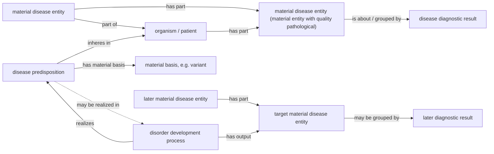

# Worked examples and competency questions

Revised copy, 2026-10-31, aligned with `mild_2026-10-30g.ttl`. The original file is kept unchanged beside it. Changes: class names and IRIs follow the current MILD (one `material disease entity`, defined by the quality `pathological`; no separate `pathological disorder`, `material complication disease entity` or `realized disease predisposition`); the CQ3 formal-risk note is settled; every competency question now carries the result of the reasoner test in `Disease ontologies/tests/` (runner `run_mild_cq_tests.py`, data `mild_cq_test_2026-10-30.ttl`, probes `mild_cq_probes_2026-10-30.ttl`, queries `mild_cq_queries.md`).

First draft for the disease-modelling proposal. The examples are written at the pattern level rather than as final ABox test data. They are intended to make explicit what the ontology should entail, what it should not entail, and where the current axioms may need adjustment before reasoner validation.

Relevant core classes (current IRIs):

- `material disease entity` (`MILD_120020`), exact synonym "pathological disorder": a material entity that has quality `pathological`; the class is defined by that equivalence, so a disorder is asserted as a material entity with a pathological quality and the reasoner classifies it
- `pathological` (`MILD_120102`), the quality; asserted, never inferred
- `disorder development process` (`MILD_120021`): has output some material disease entity
- `disease predisposition` (`MILD_120023`): a tendency inhering in a Homo sapiens with a material basis
- `pathological genetic predisposition` (`MILD_120008`), with material basis a `pathogenic genetic variant` (`MILD_120013`, itself a material disease entity)
- `predisposition realizing disorder development process` (`MILD_120012`)
- `disease diagnostic result` (`MILD_120024`), `disease stage classification result` (`MILD_120054`), `disease threshold specification` (`MILD_120029`)
- `course of the disease process` (`MILD_120028`)
- `disorder creating disease course process` (`MILD_120053`): both a disorder development process and a course of the disease process

No longer in MILD: `pathological disorder` (`MILD_120022`, obsolete; the name lives on as a synonym of `MILD_120020`), `material complication disease entity`, `disease complication diagnostic result`, `realized disease predisposition`, `compound pathological disorder`.

Reasoner validation: all six competency questions pass under ELK over the full MILD import closure (run of 2026-10-30, `tests/run_mild_cq_tests.py`); the ontology with the test individuals is consistent and has no unsatisfiable class.

---

## 1. Simple single-disorder disease

### Narrative

A patient has one pathological disorder, for example an inflamed appendix or a localized pathological lesion. A clinician produces a diagnostic result that groups this disorder as one disease. The disease is not identical with the diagnostic result: the disease is the material entity constituted by the pathological disorder in the patient, while the diagnostic result is an information content entity about that disorder.

### Pattern

Individuals in the example:

- `patient_1`: an instance of `Homo sapiens`
- `disorder_1`: a material entity that has quality an instance of `pathological` (the reasoner classifies it as `material disease entity`)
- `disease_1`: an instance of `material disease entity`
- `diagnosis_1`: an instance of `disease diagnostic result`

Assertions:

```text
patient_1 type Homo sapiens
disorder_1 type material entity
disorder_1 has quality pathological_1
pathological_1 type pathological
disorder_1 part of patient_1
disease_1 type material disease entity
disease_1 part of patient_1
disease_1 has part disorder_1
diagnosis_1 type disease diagnostic result
diagnosis_1 is about disorder_1
```

### Expected entailments

- `disorder_1` is a material disease entity, via the equivalence of `material disease entity` with 'material entity and has quality some pathological'.
- `disease_1` is a material entity, via `material disease entity`.
- `disease_1` is disjoint from `disease predisposition` (asserted disjointness; a probe class 'disease predisposition and material disease entity' is unsatisfiable).
- `diagnosis_1` is an information content entity, not a material entity.
- The model allows the same material disorder to be the object of diagnosis without making the diagnosis part of the disease.

### Expected non-entailments

- The ontology should not infer that every pathological disorder already has a diagnostic result.
- The ontology should not infer that all pathological disorders in the same patient belong to the same disease.
- The diagnostic result should not be inferred to be a material disease entity.
- A disease category name should not be inferred from the material disorder unless a classification result or category-specific axiom is asserted.

---

## 2. Complication: disease A produces a disorder grouped under disease B

### Narrative

A patient has disease A, grounded in disorder set `S_A`. During the course of disease A, a process produces a new pathological disorder. That new disorder is not merely another part of disease A by default. It can be grouped by a later diagnostic result as disease B, yielding a material complication disease entity.

Example reading: diabetes-associated pathological processes produce a retinal disorder. The retinal disorder can then be grouped under diabetic retinopathy as a complication disease. The important point is not the clinical example itself, but the ontological distinction between the producing disease course and the newly grounded disease entity.

### Pattern

Individuals in the example:

- `patient_2`: an instance of `Homo sapiens`
- `disorder_A`: a material entity with a `pathological` quality (classified as `material disease entity`)
- `disease_A`: an instance of `material disease entity`
- `course_A`: an instance of `course of the disease process`
- `complication_process`: an instance of `disorder creating disease course process`
- `disorder_B`: a material entity with a `pathological` quality (classified as `material disease entity`)
- `disease_B`: an instance of `material disease entity` (the complication disease is a material disease entity like any other; the grouping is done by its diagnostic result)
- `diagnosis_B`: an instance of `disease diagnostic result`

Assertions:

```text
patient_2 type Homo sapiens
disorder_A type material entity
disorder_A has quality pathological_A
pathological_A type pathological
disorder_A part of patient_2
disease_A type material disease entity
disease_A has part disorder_A
disease_A part of patient_2

course_A type course of the disease process
course_A has participant disease_A

complication_process type disorder creating disease course process
complication_process part of course_A
complication_process has output disorder_B

disorder_B type material entity
disorder_B has quality pathological_B
pathological_B type pathological
disorder_B part of patient_2

disease_B type material disease entity
disease_B has part disorder_B
disease_B part of patient_2

diagnosis_B type disease diagnostic result
diagnosis_B is about disorder_B
```

### Expected entailments

- `complication_process` is a disorder development process and a course of the disease process, because `MILD_120053` is a subclass of both.
- `complication_process` is part of disease A's course.
- `disorder_B` is a material disease entity (inferred from its pathological quality) and a material entity.
- `disease_B` is a material disease entity.
- The model can represent disease B as materially grounded in a disorder produced during the course of disease A.

### Expected non-entailments

- The ontology should not infer that `disease_A` and `disease_B` are the same disease.
- The ontology should not infer that `disorder_B` is part of `disease_A` merely because it was produced during disease A's course.
- The ontology should not infer that every disorder produced during a disease course is automatically a complication disease; a grouping/diagnostic classification still matters.
- The ontology should not infer that disease B existed before `disorder_B` was produced.

### Modelling check

This example is a good test of the proposal's central claim: material production and diagnostic grouping are distinct. The producing process belongs to the biological layer; the classification of the produced disorder as disease B belongs to the epistemic layer.

---

## 3. Genetic predisposition without the target disease

### Narrative

A patient carries a pathogenic genetic variant that grounds an elevated risk for a future disorder. The variant is a present material entity. The predisposition is a tendency inhering in the patient and grounded in that variant. The future target disorder does not yet exist.

Example reading: a patient carries a BRCA1 pathogenic variant. The variant grounds a predisposition to a future breast/ovarian pathological disorder, but the variant is not itself the target cancer disease.

### Pattern

Individuals in the example:

- `patient_3`: an instance of `Homo sapiens`
- `variant_1`: an instance of `pathogenic genetic variant` (in the current MILD a subclass of `material disease entity`)
- `predisposition_1`: an instance of `pathological genetic predisposition`
- `target_development_process`: a possible future `predisposition realizing disorder development process`
- `target_disorder`: a possible future material disease entity

Assertions for the intended biological situation:

```text
patient_3 type Homo sapiens
variant_1 type pathogenic genetic variant
variant_1 part of patient_3
predisposition_1 type pathological genetic predisposition
predisposition_1 inheres in patient_3
predisposition_1 has material basis variant_1
```

If the predisposition is realized later:

```text
target_development_process type predisposition realizing disorder development process
target_development_process realizes predisposition_1
target_development_process has output target_disorder
target_disorder type material entity
target_disorder has quality pathological_t
pathological_t type pathological
target_disorder part of patient_3
```

### Expected entailments

- `predisposition_1` is a disease predisposition and a tendency.
- `predisposition_1` is not a material disease entity.
- `predisposition_1` is not a material disease entity (probe class unsatisfiable).
- `variant_1` is a material entity.
- If `target_development_process` is asserted, it can be represented as producing `target_disorder`.

### Expected non-entailments

- The ontology should not infer that the target disorder already exists merely because the predisposition exists.
- The ontology should not infer that `variant_1` is itself the target disorder. (A pathogenic genetic variant is a material disease entity in its own right in the current MILD; it is a different individual from the target disorder.)
- The ontology should not infer that every genetic variant is pathological.
- The ontology should not infer that every patient with the predisposition will develop the target disorder.

### Modelling check (settled)

`disease predisposition` carries no `has realization` axiom. Its only necessary conditions are: a tendency, inheres in some Homo sapiens, has a material basis some material entity. Realization is asserted only on the process side: `predisposition realizing disorder development process` (`MILD_120012`) realizes some disease predisposition. The reasoner test checks, at class level, that no superclass of `disease predisposition` (up to BFO `realizable entity`) forces a realization or a disorder development process; it holds.

---

## Competency questions

### CQ1. Can a patient have a pathological disorder without a diagnosis?

Expected answer: yes.

Required pattern:

```text
patient has part disorder
disorder type material entity
disorder has quality pathological_1
pathological_1 type pathological
```

Expected non-entailment: no diagnostic result should be inferred from the mere existence of the disorder.

Reasoner check (ELK, 2026-10-30): PASS. The disorder is inferred to be a material disease entity; no information entity is about it; no superclass of `material disease entity` forces a diagnostic result.

### CQ2. Can two diagnostic results group overlapping but non-identical disorder sets?

Expected answer: yes, if disease individuation is classification-relative.

Required pattern:

```text
diagnosis_A is about disorder_1
diagnosis_A is about disorder_2
diagnosis_B is about disorder_2
diagnosis_B is about disorder_3
```

Expected non-entailment: the ontology should not collapse `diagnosis_A` and `diagnosis_B`, nor should it force their corresponding material disease entities to be identical merely because the grouped disorder sets overlap.

Reasoner check (ELK, 2026-10-30): PASS. Checked as: no `owl:sameAs` inferred between the two results or the two diseases; `is about` and `has part` are neither functional nor inverse functional in the closure; no cardinality cap on `is about` above `disease diagnostic result`. The pairs are asserted `owl:differentFrom`, which HermiT would turn into an inconsistency if an identity were forced (ELK ignores it).

### CQ3. Can a predisposition exist without the target disorder already existing?

Expected answer: yes in the intended model.

Formal-risk note, settled: `disease predisposition` has no `has realization` axiom (and `realized disease predisposition` does not exist). The existential sits only on `predisposition realizing disorder development process`, pointing from the process to the predisposition.

Reasoner check (ELK, 2026-10-30): PASS. An unrealized `pathological genetic predisposition` is classified as disease predisposition, tendency and realizable entity; no realization and no process is inferred for it; no superclass forces one; `genetic variant` is not a subclass of `material disease entity`; the probe class 'disease predisposition and material disease entity' is unsatisfiable. The realized branch (a second patient) classifies the realizing process as a disorder development process and its output as a material disease entity.

### CQ4. Can a disease persist while its material constituents change?

Expected answer: yes.

Required pattern:

```text
disease_1 type material disease entity
disease_1 has part disorder_state_t1
disease_1 has part disorder_state_t2
disorder_state_t1 historically/causally continuous with disorder_state_t2
```

Expected entailment: `disease_1` remains one material continuant if the disorder lineage is historically and causally continuous.

Expected non-entailment: the ontology should not identify disease persistence with exact sameness of all material parts at every time.

Reasoner check (ELK, 2026-10-30): PASS, as far as OWL can express it (no time index): one `material disease entity` keeps two successive constituents (the second `derives from` the first), both inferred material disease entities; the two are not identified; no superclass of `material disease entity` closes or caps `has part`.

### CQ5. Can a complication disorder be produced by disease A but grouped as disease B?

Expected answer: yes.

Expected entailment: the producing process can be part of disease A's course while the output disorder is grouped by a disease-B diagnostic result.

Expected non-entailment: disease A and disease B should not be inferred identical.

Reasoner check (ELK, 2026-10-30): PASS. The `disorder creating disease course process` is inferred to be a disorder development process, a course of the disease process and a process; its output disorder is inferred a material disease entity and is grouped by disease B's diagnostic result; it is not inferred part of disease A; the two diseases are not identified.

### CQ6. Is a diagnostic category itself a disease?

Expected answer: no.

Expected entailment: diagnostic categories/results belong to the information/epistemic layer.

Expected non-entailment: DOID categories, diagnostic results, threshold specifications, and classification outputs should not be inferred to be material disease entities.

Reasoner check (ELK, 2026-10-30): PASS. Diagnostic results, a stage classification result and a threshold specification are inferred information content entities and generically dependent continuants, never material; the probe classes 'disease diagnostic result and material disease entity', 'disease stage classification result and material disease entity', 'disease threshold specification and material disease entity' and 'information content entity and material disease entity' are all unsatisfiable (the last two through the BFO/IAO closure, not through an asserted disjointness). For DOID the test shows only the non-entailment: no DOID class is a subclass of `material disease entity`. The DOID module gives `disease` (`DOID_4`) no parent class, so MILD cannot rule out by axiom that a DOID category has a material disease entity as instance.

---

## Small diagram



Diagram note: the dashed `may be realized in` arrow is intentionally weaker than an OWL existential `has realization some ...`, and MILD has no such existential. The only asserted link is `realizes` from the realizing process to the predisposition, which exists only once the process does. This preserves the intended case where a predisposition exists before the target disorder exists.
