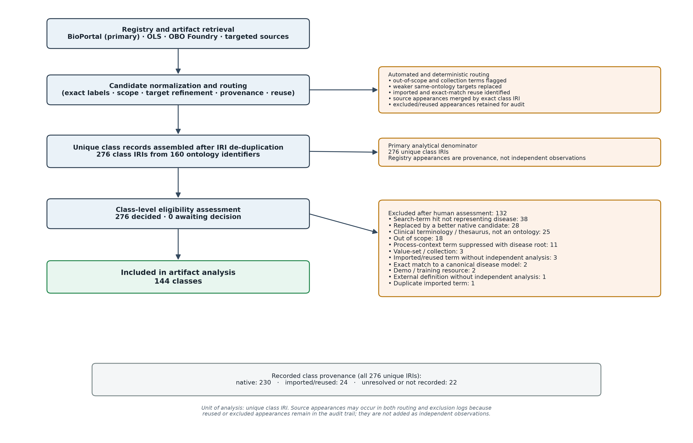
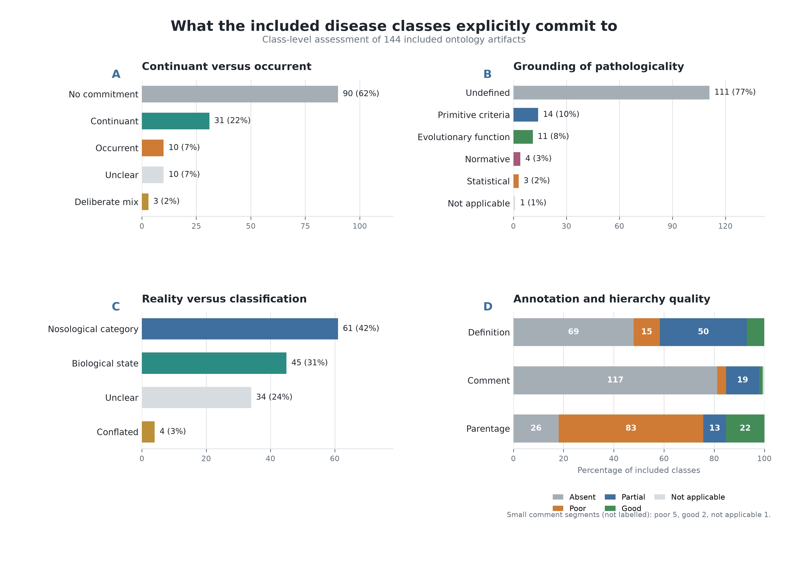

# How Is Disease Formally Modelled in Biomedical Ontologies? A Systematic Cross-Sectional Evaluation of Public Ontology Artifacts

**Moritz Milewski, MD^1,2 and Martin Boeker, MD, MME, MCSc^3**

1. Section of Plastic and Reconstructive Surgery, Department of Surgery, Yale School of Medicine, New Haven, Connecticut, USA  
2. Department of Plastic, Aesthetic, Hand and Reconstructive Surgery, Hannover Medical School, Hannover, Germany  
3. Chair of Medical Informatics, Technical University of Munich, Munich, Germany

**Positions:** Moritz Milewski, MD, is a Postdoctoral Research Fellow in Plastic and Reconstructive Surgery at Yale School of Medicine and a resident in Plastic Surgery at Hannover Medical School. Martin Boeker, MD, MME, MCSc, is a Full Professor at the Technical University of Munich.  
**Corresponding author:** Moritz Milewski, MD, Yale School of Medicine, 333 Cedar Street, New Haven, CT 06510, USA; telephone: +1 203-392-4520; email: moritz.milewski@yale.edu; alternate email: milewski.moritz@mh-hannover.de  
**ORCID:** Moritz Milewski, 0009-0006-6251-7592; Martin Boeker, 0000-0003-2972-2042  
**Keywords:** disease; biomedical ontology; knowledge representation; ontology evaluation; semantic interoperability

*Target journal and article type: Journal of the American Medical Informatics Association (JAMIA), Research and Applications, using the standard subscription publication route. Draft v0.7, 12 August 2026. The study analyses primary digital artifacts and is not a scoping or systematic review of secondary literature. Citations remain in author-year form during drafting and will be converted in Zotero to the journal's numbered style before submission.*

> ## Outstanding work before submission
>
> 1. Complete the prespecified independent 50-class stratified validation, retain both assessors' original codes, reconcile disagreements, and insert agreement results.
> 2. Reconcile the reference inventory in Zotero and convert it to JAMIA style.
> 3. Freeze the master CSV, regenerate the supplementary TTL files and Figures 1 and 2, rerun all checks, and rebuild the release archive.

## Abstract

### Objective

To determine how public biomedical ontologies formally represent disease, assess the explicitness and quality of their grounding, and identify implications for semantic interoperability.

### Materials and Methods

We systematically evaluated artifacts retrieved from BioPortal, the Ontology Lookup Service, the OBO Foundry, and targeted repositories between 29 June and 6 July 2026. The unit was a unique OWL/RDFS class IRI. Exact-label and sensitivity results were deduplicated by IRI and screened using deterministic routing. One assessor examined labels, definitions, comments, mappings, provenance, and asserted superclasses. Variables captured ontological category, pathological grounding, gradedness, reality-versus-classification commitments, and entity quality. Publications were ancillary evidence. Independent stratified validation is planned.

### Results

The dataset contained 276 class IRIs; 144 were included and 132 excluded. Of included classes, 99 (69%) had no identifiable disease model, 23 followed a disposition, realizable-entity, or dependent-continuant route, and eight represented disease as a process. Pathologicality was undefined in 111 (77%); all were silent about gradedness; and 10 definitions (7%) were good. BFO-aligned classes had better parentage and higher quality scores, although the comparison partly reflects the rubric.

### Discussion

Disease labels were widespread, but explicit models were uncommon. Grounded implementations concentrated around BFO and OGMS. Shared labels and mappings provided weak evidence of semantic compatibility.

### Conclusion

Developers should reuse and cite a grounded disease pattern or document an intentional alternative. A bare `Disease` class is insufficient for integration.

## Lay Summary

Biomedical databases often use ontology classes called “disease,” “disorder,” or “condition” to combine information from different sources. The same label does not guarantee that these classes mean the same kind of thing. We systematically inspected publicly available ontology classes and assessed their definitions, explanatory comments, and position in the class hierarchy. Most classes did not state whether a disease is a persistent property of a person, a process unfolding over time, a biological state, or merely a classification label. Explicitly grounded classes most often followed the Basic Formal Ontology and Ontology for General Medical Science pattern, in which a disease is a disposition grounded in a bodily disorder and realized through pathological processes. These classes were generally easier to interpret than classes without an identifiable upper-level model. Our dataset records both the retrieved evidence and the assessment for every class. It can help ontology developers and health-data integrators identify when apparently equivalent disease labels conceal incompatible meanings.

## Background and Significance

Disease is a central integration point for clinical records, molecular pathways, phenotypes, exposures, diagnostic criteria, and research cohorts. Ontologies make these data computable by placing classes in formal hierarchies and connecting them through mappings. The apparent simplicity of a class labelled *disease*, *disorder*, or *condition* is therefore deceptive. Depending on the ontology, the class may denote an abnormal material structure, a disposition borne by a patient, a process unfolding through time, a state or quality, an observable finding, or a diagnostic or nosological category. These are not stylistic variants. Continuants persist whereas occurrents happen; qualities and dispositions depend on bearers; diagnoses are information entities; and classificatory categories can change without a corresponding change in the patient. Aligning such classes on the strength of labels or mappings alone can consequently join entities with incompatible identity, temporal, and causal conditions.

The underlying problem is that ordinary clinical discourse compresses several distinguishable layers into the word *disease*. At minimum, a representation may need to distinguish the material abnormality in a body, the patient's disposition or tendency toward manifestations, the pathological processes and causal history through which the condition develops, the observable phenotype, and the diagnostic act or classification that groups these features under a disease name. A reusable disease model must make those layers relatable without making them identical: a revised diagnostic threshold should be able to change classification without implying that the patient's underlying material condition changed at the same moment. Clinical knowledge further mixes universal claims with typical, probabilistic, and threshold-dependent statements. OWL axioms applying to every class member cannot safely encode statements that are merely usual or clinically expected (Schulz et al., 2009). A formally coherent disease hierarchy can therefore remain conceptually ambiguous about what its classes denote and can turn clinical defaults or coding conventions into unintended universal assertions.

Basic Formal Ontology (BFO) provides a disciplined top-level distinction between continuants and occurrents and between independent and dependent entities (Arp et al., 2015). This is valuable because it exposes category mistakes that an unstructured disease hierarchy can hide. The same discipline, however, creates a modelling burden: the clinically broad term *disease* must be assigned to one category or decomposed into several related entities. BFO itself is not a theory of disease and does not determine which decomposition is appropriate. The BFO-aligned Ontology for General Medical Science (OGMS) addresses this problem by distinguishing a material disorder, a disease disposition grounded in that disorder, pathological processes that manifest the disorder, a disease course comprising the realizing processes, and a diagnosis about the patient (Scheuermann et al., 2009). This pattern explains how disease can exist before overt manifestation and prevents a diagnosis or symptom from being identified with the disease itself.

The OGMS solution is coherent but not complete. Its disease class foregrounds a realizable potential while placing the material substrate and unfolding causal history in neighbouring classes. This can make the causal organization by which a disease develops and persists less visible at the disease node itself (Rovetto et al., 2015). The wider realizable-entity hierarchy also remains contested: graded and counteractable tendencies are difficult to capture as simple present-or-absent dispositions, and treating function as a special disposition creates problems for representing malfunction, in which a bearer may retain a function while lacking the corresponding capacity (Jansen, 2007; Röhl et al., 2014). Most importantly, top-level placement cannot by itself determine what makes a disorder or process *pathological*. OGMS offers clinically oriented abnormality criteria involving organism type, risk, dysfunction, and thresholds, but their application still depends on reference populations and clinical judgement (Scheuermann et al., 2009). A class can therefore be impeccably placed under a BFO category while remaining silent about the basis on which it counts as disease.

BioTop was developed partly in response to the effort and maintenance burden of forcing every practical disease term immediately into a structure-disposition-process decomposition. Its `PathologicalEntity` pattern deliberately forms a disjunction of pathological structure, pathological disposition, and pathological process, permitting a disease or SNOMED CT-style *condition* to be represented and anatomically located before its more specific ontological category is known. The intended benefit is scalability and “graceful evolution”: an initially under-specified class can later be refined without disrupting the surrounding ontology (Schulz et al., 2011). What BioTop adds is therefore not another single answer to what disease is, but an explicit representation of temporary or application-driven under-commitment. The trade-off is that the disjunctive parent does not enforce one identity criterion for its subclasses. Unless refinement actually occurs, a shared `Condition` superclass can preserve rather than resolve the ambiguity between material pathology, disposition, and process.

Causal and process-sensitive approaches address a different weakness. The River Flow Model and its YAMATO foundation characterize disease through causally connected abnormal states and processes, using the river analogy to explain persistence despite changing material realization (Mizoguchi et al., 2011; Rovetto et al., 2015; Mizoguchi et al., 2022). This should not be reduced to the claim that disease is merely a process: the central idea is a persisting entity individuated by a causal-process structure. It restores mechanism, development, and historical continuity to the centre of disease identity. Yet it also inherits difficult questions about which causal relata and boundaries constitute one disease, how overlapping causal chains are individuated, and how the model can interoperate with the BFO-dominated OBO ecosystem. In addition, the relevant River Flow and YAMATO artifacts were not available through the registries or working source links examined in this study, preventing artifact-level comparison.

Large disease resources solve still another problem. The Human Disease Ontology and Mondo supply broad classificatory coverage, synonym management, mappings, and integration across clinical and research sources (Schriml et al., 2022; Vasilevsky et al., 2022). Such resources are indispensable for data linkage, but classificatory utility and ontological grounding are different achievements. A resource may import an OGMS-aligned root while organizing many descendants pragmatically by anatomy, etiology, phenotype, or source terminology. Mappings can document correspondence without guaranteeing that both mapped classes make the same continuant, process, material, or epistemic commitment. Precision-medicine groupings add another legitimate use: patients may be stratified computationally by interacting genotype, phenotype, environment, mechanism, and treatment response even when the resulting group is not intended as a single intrinsic disease universal (Haendel et al., 2018).

No choice among these formal approaches removes the philosophical problem of pathologicality. Naturalist accounts relate disease to statistically subnormal species-typical function (Boorse, 1977); evolutionary and hybrid accounts invoke dysfunction, sometimes together with harm (Wakefield, 1992); normative accounts emphasize disvalue or impairment (Engelhardt, 1975); and disease-entity accounts treat pathologicity as a medically primitive concept constrained by explicit criteria (Hucklenbroich, 2014). Biological and clinical boundaries may also be graded even though ordinary OWL classes are crisp (Sadegh-Zadeh, 2000). The present study does not attempt to settle those philosophical disputes. It uses them to ask whether an ontology states any grounding at all and whether biological reality, clinical manifestation, and classification are kept distinguishable.

Four coupled questions accordingly expose the commitments most relevant to interoperability. First, is disease represented as a continuant, an occurrent, a deliberate cross-category construction, or left unspecified? Second, what grounds the judgement that the represented entity is pathological: statistical comparison, evolutionary dysfunction, normative harm, explicit primitive criteria, or nothing stated? Third, does the ontology address crisp versus graded membership? Fourth, does the class denote an underlying biological entity, an illness role, a nosological category, a precision-medicine stratification, or a conflation of these? Published proposals show what can be modelled, but they do not establish what users actually encounter in contemporary public ontology artifacts.

This study therefore treats ontology classes, rather than publications, as primary data. We performed a systematic cross-sectional evaluation to enumerate retrievable disease-class candidates, identify their asserted upper-level and superclass commitments, assess the explanatory evidence supplied by definitions and comments, and determine how often the competing models described above are implemented explicitly. The goal was not to select a universally correct definition of disease, but to determine whether current artifacts provide enough ontological grounding for their disease classes to be interpreted, compared, and reused without relying on lexical agreement alone.

## Materials and Methods

### Study Design and Data Sources

We conducted a systematic cross-sectional evaluation of machine-readable ontology artifacts. BioPortal was the primary sampling frame; the EBI Ontology Lookup Service (OLS) and active OBO Foundry products provided supplementary coverage. Targeted GitHub or ontology-site retrieval was used only to resolve known artifacts or replacement classes. Searches and retrieval occurred from 29 June through 6 July 2026. Registry timestamps, URLs, ontology identifiers, and available version metadata were retained.

The primary observational unit was one OWL/RDFS class identified by IRI together with its retrievable labels, definitions, comments, synonyms, asserted named superclasses, mappings, and source metadata. One class appearing in several registries or importing ontologies was represented once in the analytical table, while all source appearances were retained as provenance. Publications linked to an ontology were ancillary evidence; they were neither sampling units nor independently screened study records.

### Candidate Ascertainment

BioPortal and OLS APIs were queried using normalized exact-label matches. BioPortal searches used `GET https://data.bioontology.org/search` with `q`, `require_exact_match=true`, annotation inclusion, and 100 results per page; OLS searches used `GET https://www.ebi.ac.uk/ols4/api/search` with `q`, `exact=true`, `type=class`, `queryFields=label`, and 100 results per request. Pagination continued until each result set was exhausted. Active OBO Foundry products not represented in BioPortal were scanned directly from the registry-listed OWL or OBO artifact. Primary terms were `disease`, `disorder`, `illness`, `condition`, `health condition`, `syndrome`, `pathological process`, `pathological disposition`, and `dysfunction`, including documented capitalization and compound-label variants. Sensitivity terms covered pathological or abnormal states, morbid condition, nosological entity, and limited French and German equivalents.

Automated routing removed value-set collections, concepts outside the disease-model scope, imported appearances without independent modelling, explicit exact matches to canonical roots, and weaker same-ontology candidates. A syndrome or pathological-process hit was suppressed when the ontology exposed a more direct disease/disorder target, unless the process was itself the ontology's disease model. Local or WebProtege IRIs and sparse annotation were treated as quality concerns rather than automatic exclusions. Exact IRI was the deduplication key.

### Eligibility and Assessment

A class was eligible when it represented disease or a justified immediate conceptual neighbour and exposed sufficient artifact or registry evidence to assess at least its identity and asserted placement. Thesauri, value sets, demo resources, out-of-scope concepts, mapping-only appearances, and unmodified imported duplicates were retained in the screening record but excluded from independent synthesis. Reused classes remained eligible when the receiving ontology's placement or adaptation constituted an independent modelling decision.

One assessor examined each candidate in an interactive interface and, where necessary, in generated hierarchy modules or the source artifact. Controlled fields recorded provenance, eligibility, native/imported status, ontology type, ontological category, pathological grounding, crisp-versus-graded commitment, reality-versus-classification commitment, logical inconsistency, and a modelling comment. Definition, comment, and parentage quality were rated separately. Entity quality ranged from 0 (excluded) to 3 (good definition and superclass placement with explicit grounding). Rule-based prefills were restricted to explicit evidence patterns and remained open to human confirmation.

A second assessor will independently code a prespecified stratified sample of 50 unique IRIs while blinded to the first assessor's decisions. Raw agreement will be reported for every controlled field, Cohen's kappa for eligible nominal variables, and weighted kappa for entity-quality score. Both original assessments and the adjudicated value will be preserved.

### Analysis and Reproducibility

Counts and percentages describe eligibility, model categories, design commitments, and annotation quality. Means summarize entity-quality scores for selected model families. These are descriptive artifact-level comparisons, not causal estimates. The quality rubric includes explicit grounding and relevant parentage; comparisons involving those features are therefore partly criterion-dependent. No meta-analysis or risk-of-bias-across-studies assessment was performed because the observations are ontology classes.

The assessment was maintained in one internal class-level master table. Deterministic local processing generated a complete evidence ontology, an included-only synthesis ontology, source hierarchy modules, an audit report, and Figures 1 and 2. The submitted ontology package uses fixed non-resolving UUID URNs and a local XML catalog. Search credentials, source code, and the internal tabular working file are not included in the supplementary package.

## Results

### Artifact Selection

Registry searching, targeted retrieval, deterministic routing, and exact-IRI deduplication produced 276 unique class records from 160 recorded ontology identifiers. Primary assessment included 144 classes and excluded 132; no eligibility or citation-assignment decisions remained unresolved. Registry appearances are retained as provenance but are not added as independent observations because routing and exclusion logs deliberately overlap. These counts precede the planned independent stratified validation and may be revised if reconciliation changes a class-level decision.

**Figure 1. Ontology-artifact selection flow.** An appearance is one class in one registry/source-ontology context; a class is a unique IRI after deduplication. Dependency-only appearances are analysed at their native provider rather than counted as independent disease models.

### Disease Models and Grounding

The dominant result was absence of explicit grounding. Among 144 included classes, 99 (69%) were assigned `no_grounded_model`. Twenty-three classes formed the BFO-aligned disposition/realizable-entity/dependent-continuant family, and eight represented a process or course of events. Other categories were uncommon: three Kantian-state classes, three BioTop-style conditions, two quality models, one mixed model, one disorder model, and four unclear classes.

| Disease-model category | Classes |
|---|---:|
| No identifiable grounded model | 99 |
| Disposition, realizable entity, or dependent continuant | 23 |
| Process or course of events | 8 |
| State, BioTop condition, or quality | 8 |
| Mixed or disorder model | 2 |
| Unclear | 4 |

Pathological grounding was undefined in 111/144 classes (77%). Fourteen used explicit primitive criteria, 11 referred to evolutionary function, four were normative, three were statistical, and one was not applicable. All 144 included classes were coded silent on crisp versus graded membership: OWL representation alone was not treated as an explicit philosophical commitment.

Reality-versus-classification coding identified 61 classes (42%) as nosological categories and 45 (31%) as biological states; 34 (24%) were unclear and four (3%) conflated biological and classificatory readings.

### Annotation and Entity Quality

Definition quality was absent for 69 classes, partial for 50, poor for 15, and good for 10. Parentage was poor or absent for 109 classes. Entity-quality scores were 1 for 121 classes, 2 for 21, and 3 for two.

**Figure 2. Ontological commitments and evidence quality among included classes.** Panels show (A) continuant-versus-occurrent commitment, (B) grounding of pathologicality, (C) reality-versus-classification coding, and (D) definition, comment, and parentage quality. Bar-end labels give class counts and percentages. Numbers within the stacked bars are class counts; percentages for panel D use 144 as the denominator.

The 23 BFO-aligned continuant classes had a mean entity-quality score of 1.91/3; 19 (83%) had good parentage. All 99 ungrounded classes scored 1/3 and had poor or absent parentage. Good definitions occurred in 3/23 BFO-aligned classes and 5/99 ungrounded classes. This association does not establish that adopting BFO causes higher quality because grounding and parentage contribute to the rubric. It does show that the BFO/OGMS pattern makes category and placement more inspectable. Eleven of the 23 BFO-aligned classes still did not define pathologicality.

### Reuse and Foundational Ontologies

Dependency appearances concentrated on OGMS, DOID, MONDO, and the UMLS Semantic Type network. The landscape therefore depends on a small set of reference resources even though many consuming ontologies expose their own disease labels. BFO, usually through OGMS, was the dominant explicit foundational commitment. BioTop and SIO accounted for small condition- and quality-oriented groups. No eligible class in the retrieved artifact set committed to DOLCE, GFO, or YAMATO.

The Hozo River Flow Model was not indexed in BioPortal, OLS, or the OBO Foundry, and links inspected on the ontology laboratory website did not resolve to a downloadable artifact (Mizoguchi et al., 2011). YAMATO was likewise unavailable as an inspectable artifact (Mizoguchi et al., 2022). Their absence from the denominator reflects availability, not a negative evaluation.

## Discussion

The principal finding is that biomedical ontologies much more often label disease than model it. Nearly seven in ten included classes conveyed no identifiable account of what kind of entity a disease is. Explicit implementations were concentrated around the BFO/OGMS disposition pattern, with process, state, quality, and deliberately mixed alternatives forming a small minority. Figure 2 shows that this under-specification recurred across distinct questions: 62% made no continuant-or-occurrent commitment, 77% left pathologicality undefined, and 24% were unclear about whether the class denoted biological reality or a classification. Definitions rarely supplied what hierarchy omitted: only 7% were rated good.

This matters for interoperability. An exact label or mapping can connect a disposition, a process, a finding, and a nosological category while concealing category incompatibility. Conversely, importing a reference class can provide a shared model without creating another independent implementation. Integration workflows should therefore inspect provenance, upper-level placement, and defining axioms rather than infer semantic equivalence from lexical agreement.

### Suitability of Foundational Frameworks

BFO provided the strongest upper-level constraints among the retrieved implementations. Its continuant–occurrent and independent–dependent distinctions make it possible to detect whether a class denotes a persisting bearer-dependent entity, a material structure, or a process. Those distinctions are valuable for interoperability because they expose category errors that an unanchored hierarchy cannot reveal. BFO alone, however, is not a disease model. It neither selects one BFO category for disease nor determines what makes an entity pathological. The greater inspectability observed in BFO-aligned classes depended chiefly on an accompanying disease-level pattern.

OGMS supplied the most explicit such pattern. It relates a disease disposition to its material disorder and to the pathological processes through which it is manifested, while keeping disease course and diagnosis distinct. This combination supports presymptomatic disease and prevents diagnosis or manifestation from being identified with disease. Its limitation is that the disease node foregrounds dispositional potential rather than the causal organization and changing material substrate of the disease. In addition, pathologicality still depends on clinically interpreted abnormality criteria that are not supplied by BFO itself.

A BFO process route is appropriate when the target class genuinely denotes a molecular pathway, pathological process, or disease course. Its occurrent placement clearly states that instances unfold through time. It becomes problematic when the same class is intended to denote the disease borne by a patient, because disease is then collapsed into its manifestation or temporal course. A process-centred representation therefore still needs explicit relations to the bearer, material disorder, and any persisting disease entity or disposition.

BioTop addresses the modelling burden differently. Its condition or pathological-entity pattern deliberately permits under-commitment across pathological structure, disposition, and process. This can be useful during ontology construction or in application ontologies where available evidence does not justify a narrower category. The pattern supports later refinement without requiring disruptive remodelling. Its flexibility is also its principal limitation for semantic integration: if refinement never occurs, the shared superclass does not enforce a single identity or temporal criterion across its disease subclasses.

SIO offers a useful quality-oriented route for measurement-centred representations. It can connect disease-related qualities to observations, values, and data products without forcing a full clinical disease theory into the measurement model. Generic quality semantics, however, do not explain the causal unity of a disease, distinguish disease from its phenotype, or determine pathologicality. SIO therefore supports particular data-integration tasks but is insufficient by itself as a general disease model.

The River Flow Model and YAMATO contribute a diachronic perspective that is less explicit in a disposition-centred representation. Their published account characterizes disease through a causally continuous organization of abnormal states and processes, allowing identity to persist despite material change. This directly addresses disease development and historical continuity. The approach nevertheless requires criteria for deciding which states and processes constitute one causal whole, and its alignment with the BFO-dominated OBO ecosystem is less direct. Because no inspectable River Flow or YAMATO artifact could be retrieved, this study could assess the published proposal but not compare its implementation quality with the retrieved classes.

Classes without an identifiable top ontology retained the greatest local modelling freedom but provided the weakest shared constraints. In this dataset they offered no common mechanism for distinguishing a disposition from a process, finding, quality, or classification category, and their parentage was uniformly poor or absent under the assessment rubric. This does not show that importing a top ontology automatically produces a good disease model. It shows that an explicit upper-level commitment, combined with a disease-specific pattern, makes assumptions inspectable and category incompatibilities easier to detect.

For interoperable disease-class modelling, the evidence therefore favours BFO together with an explicit disease-level pattern such as OGMS over either bare BFO import or an unanchored disease class. BioTop is suitable when under-commitment is intentional, documented, and expected to be refined. SIO is useful for measurement-centred representations, and causal-chain approaches add an important account of development and persistence. None of these frameworks independently determines what counts as pathological; that commitment must still be stated at the disease-model level.

### Limitations

The sampling frame was limited to classes discoverable through selected registries, normalized labels, and targeted retrieval. Unindexed, idiosyncratically labelled, non-English, or inaccessible artifacts may be absent. APIs and extracted modules may omit annotations, anonymous restrictions, or imported axioms. Interpretation of definitions and hierarchy required human judgement; one assessor completed the full dataset, with only a stratified independent validation planned. Counts are a snapshot of recorded versions retrieved from 29 June through 6 July 2026. The quality comparison is partly criterion-dependent. Finally, unavailable River Flow/YAMATO artifacts prevented empirical comparison of those approaches.

## Conclusion

Public biomedical ontologies commonly provide a disease label without an explicit disease model. A small BFO/OGMS-aligned minority is more inspectably grounded, but even those classes often leave pathologicality undefined. Ontology developers should reuse and cite a coherent reference pattern or document why an alternative category is intended. Data integrators should treat lexical agreement among disease, disorder, and condition classes as a prompt for ontological inspection rather than evidence of equivalence.

## Funding

No dedicated external funding supported this study. Funding for individual ontology projects was not systematically available from artifact metadata and was not analysed.

## Ethics Approval

The study used publicly accessible digital artifacts and bibliographic metadata and involved no human participants, patient data, or animal research. Institutional ethics approval and consent were not required.

## Competing Interests

The authors declare no competing interests.

## Author Contributions

Moritz Milewski: Conceptualization; Data curation; Formal analysis; Investigation; Methodology; Project administration; Software; Visualization; Writing - original draft; Writing - review and editing. Martin Boeker: Supervision; Writing - review and editing. Proofreading is included under Writing - review and editing. Add Validation to the appropriate author only after completion of the independent stratified assessment.

## Acknowledgements and Generative AI Disclosure

A generative AI coding assistant supported script development, deterministic transformations, quality-control checks, and language editing. It did not autonomously determine eligibility or final interpretive codes and does not qualify as an author. The authors take responsibility for all decisions and claims. **[Confirm against JAMIA's disclosure requirements at submission.]**

## Data Availability

Supplementary Data S1 (`disease_terms_review.ttl`) contains all 276 class-level evidence, provenance, eligibility, and assessment records. Supplementary Data S2 (`disease_terms_synthesis.ttl`) contains the 144 included records used in the synthesis. `review_core.ttl`, the native hierarchy TTL modules, and `catalog-v001.xml` accompany these files solely to provide their declarations and local import resolution. The UUID-URN ontology package is self-contained and is not maintained as a public web ontology. No CSV, Python source code, credentials, or API keys are distributed as supplementary material.

## References

*Draft inventory for Zotero reconciliation. Convert to JAMIA's numbered style before submission.*

Arp, R., Smith, B., & Spear, A. D. (2015). *Building ontologies with Basic Formal Ontology*. MIT Press.

Boorse, C. (1977). Health as a theoretical concept. *Philosophy of Science, 44*(4), 542-573. https://doi.org/10.1086/288768

Ceusters, W., & Smith, B. (2010). Foundations for a realist ontology of mental disease. *Journal of Biomedical Semantics, 1*, 10. https://doi.org/10.1186/2041-1480-1-10

Engelhardt, H. T., Jr. (1975). The concepts of health and disease. In H. T. Engelhardt Jr. & S. F. Spicker (Eds.), *Evaluation and explanation in the biomedical sciences* (pp. 125-141). Reidel. https://doi.org/10.1007/978-94-010-1769-5_9

Ereshefsky, M. (2009). Defining health and disease. *Studies in History and Philosophy of Biological and Biomedical Sciences, 40*(3), 221-227. **[Verify in Zotero.]**

Goldfain, A., Smith, B., & Cowell, L. G. (2010). Dispositions and the Infectious Disease Ontology. In *Formal Ontology in Information Systems: Proceedings of FOIS 2010* (pp. 400-413). IOS Press. https://doi.org/10.3233/978-1-60750-535-8-400

Haendel, M. A., McMurry, J. A., Relevo, R., Mungall, C. J., Robinson, P. N., & Chute, C. G. (2018). A census of disease ontologies. *Annual Review of Biomedical Data Science, 1*, 305-331. https://doi.org/10.1146/annurev-biodatasci-080917-013459

Hucklenbroich, P. (2014). Disease entity as the key theoretical concept of medicine. *Journal of Medicine and Philosophy, 39*(6), 609-633. https://doi.org/10.1093/jmp/jhu040

Jansen, L. (2007). Tendencies and other realizables in medical information sciences. *The Monist, 90*(4), 534-554. https://doi.org/10.5840/monist200790436

Mizoguchi, R., Kozaki, K., Kou, H., Yamagata, Y., Imai, T., & Ohe, K. (2011). River Flow Model of diseases. In *Proceedings of the International Conference on Biomedical Ontology 2011* (pp. 63-70). **[Verify in Zotero.]**

Mizoguchi, R., & Borgo, S. (2022). YAMATO: Yet-another more advanced top-level ontology. *Applied Ontology, 17*(1), 211-232. https://doi.org/10.3233/AO-210257

Röhl, J., & Jansen, L. (2014). Why functions are not special dispositions: An improved classification of realizables for top-level ontologies. *Journal of Biomedical Semantics, 5*, 27. https://doi.org/10.1186/2041-1480-5-27

Rovetto, R. J., & Mizoguchi, R. (2015). Causality and the ontology of disease. *Applied Ontology, 10*(2). https://doi.org/10.3233/AO-150147 **[Add pages from Zotero.]**

Sadegh-Zadeh, K. (2000). Fuzzy health, illness, and disease. *Journal of Medicine and Philosophy, 25*(5), 605-638. https://doi.org/10.1076/0360-5310(200010)25:5;1-W;FT605

Scheuermann, R. H., Ceusters, W., & Smith, B. (2009). Toward an ontological treatment of disease and diagnosis. *Summit on Translational Bioinformatics*, 116-120. PMCID: PMC3041577.

Schriml, L. M., et al. (2022). The Human Disease Ontology 2022 update. *Nucleic Acids Research, 50*(D1), D1255-D1261. https://doi.org/10.1093/nar/gkab1063

Schulz, S., Spackman, K., James, A., Cocos, C., & Boeker, M. (2011). Scalable representations of diseases in biomedical ontologies. *Journal of Biomedical Semantics, 2*(Suppl 2), S6. https://doi.org/10.1186/2041-1480-2-S2-S6

Schulz, S., Stenzhorn, H., Boeker, M., & Smith, B. (2009). Strengths and limitations of formal ontologies in the biomedical domain. *RECIIS - Electronic Journal of Communication, Information and Innovation in Health, 3*(1), 31-45. https://doi.org/10.3395/reciis.v3i1.241en

Vasilevsky, N. A., et al. (2022). Mondo: Unifying diseases for the world, by the world. *medRxiv*. https://doi.org/10.1101/2022.04.13.22273750 **[Check for a peer-reviewed replacement in Zotero.]**

Wakefield, J. C. (1992). The concept of mental disorder: On the boundary between biological facts and social values. *American Psychologist, 47*(3), 373-388. https://doi.org/10.1037/0003-066X.47.3.373

## Supplementary Ontology Files

- **Supplementary Data S1:** `disease_terms_review.ttl`, the complete evidence and assessment ontology.
- **Supplementary Data S2:** `disease_terms_synthesis.ttl`, the included-only synthesis ontology.
- **Ontology support files:** `review_core.ttl`, `native_hierarchy_modules/*.ttl`, and `catalog-v001.xml`, bundled with S1 and S2 for local import resolution rather than treated as additional analytical supplements.
